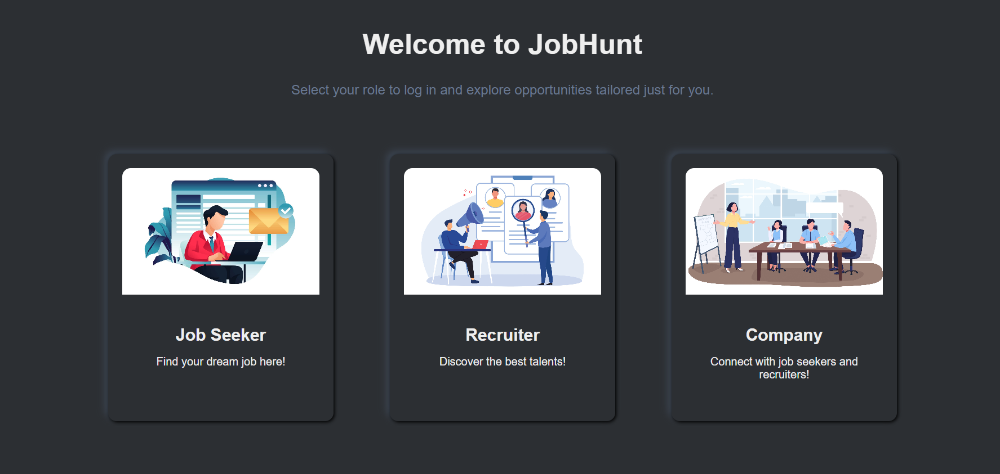

# JobHunt – Job Search & Professional Networking Platform

JobHunt is a full-stack web application designed to connect job seekers, recruiters, and companies through a unified platform. It provides job discovery, professional networking, profile management, and recruitment-related features.

**Live Demo:** https://job-hunt-zeta-gold.vercel.app/

## Application Preview

### Homepage

### Role Selection & User Profiles

## Key Features

- **Three User Roles:** Dedicated experiences for Job Seekers, Recruiters, and Companies.
- **Profile Management:** Create and manage professional profiles with skills, education, experience, and social links.
- **Job Search:** Explore job opportunities with filtering functionality.
- **Job Management:** Create and manage job postings.
- **Professional Networking:** Follow users and share professional updates through posts.
- **Post Analytics:** View graphical analytics of post engagement.
- **Theme Customization:** Dark and light modes with saved preferences.
- **Account Settings:** Manage account preferences, logout, and profile deletion.

## Technology Stack

| Component | Technologies |
|---|---|
| Frontend | React.js, JavaScript, HTML5, CSS3 |
| Backend | Node.js, Express.js |
| Database | MongoDB |
| Authentication | Firebase Authentication |
| Deployment | Vercel |
| Libraries & Tools | Axios, FontAwesome, Recharts |

## Key Highlights

- Developed a full-stack web application with frontend and backend integration.
- Implemented user authentication and role-based functionality.
- Integrated REST APIs for application functionality.
- Built interactive interfaces and data visualisations.
- Implemented profile management and persistent theme preferences.

## Key Learnings

Gained practical experience in full-stack web development, API integration, database management, authentication, and building interactive web applications.

---

**Developed by Akanksha Uniyal**
